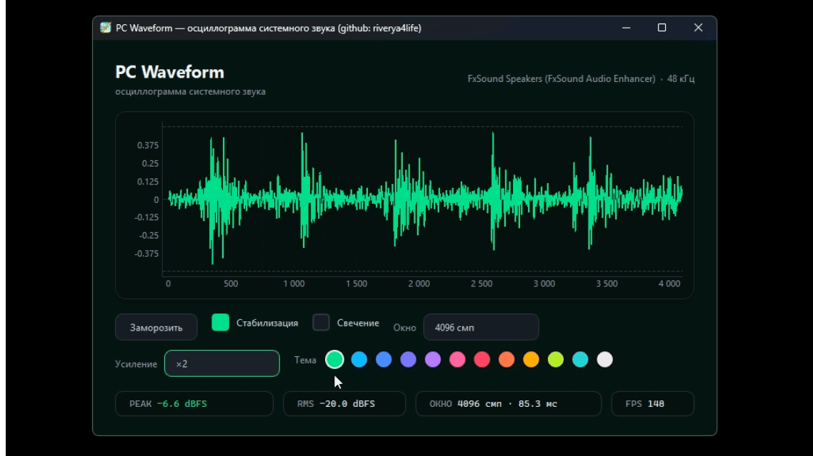

# PC Waveform — Осциллограмма системного звука

Реалтайм-осциллограмма звука с ПК через WASAPI loopback в современном тёмном интерфейсе.

Высокий FPS, плавная стабилизация, красивые цветовые темы и минималистичный UI.



---

## ✨ Обзор

**PC Waveform** — это визуализатор системного звука, построенный на **Python**, **PyQt6**, **pyqtgraph**, **NumPy** и **SoundCard**.

Программа захватывает звук, который реально играет на компьютере (loopback), и отображает чистую осциллограмму с:

- Стабилизацией по фронту сигнала
- Регулируемым окном и усилением
- Эффектом свечения
- 12 цветовыми темами с плавной анимацией
- Отображением Peak / RMS / FPS

Идеально подходит для мониторинга звука, стримов и просто визуального кайфа.

---

## 🎛 Возможности

### Audio Engine

- Реалтайм-захват системного звука (WASAPI Loopback)
- Высокий FPS (обновление ~1 мс)
- Стабилизация осциллограммы (триггер по фронту + гистерезис + захват фазы)
- Настраиваемый размер окна (1024 / 2048 / 4096 / 8192 сэмплов)
- Усиление ×1 / ×2 / ×4 / ×8
- Отображение Peak и RMS в dBFS

### Визуал

- Современный тёмный интерфейс
- 12 акцентных цветовых тем с анимацией перехода
- Эффект свечения осциллограммы
- Плавная заморозка / продолжение
- Адаптивный layout
- Тёмный titlebar в Windows

---

## 🖥 Платформа

Основная платформа:

- **Windows (WASAPI loopback)**

Другие системы могут работать в зависимости от поддержки `soundcard`, но Windows — приоритетная цель.

---

## 🚀 Установка

```bash
pip install -U numpy soundcard pyqtgraph PyQt6
python pc_waveform.py
```

## Кратко о программе

Это осциллограф системного звука на Python: `soundcard` захватывает WASAPI-loopback в кольцевой буфер (моно + L + R), UI на `pyqtgraph` рисует кривую (с триггером/стабилизацией, свечением, затуханием краёв), а рядом — плашки PEAK/RMS/Hz/FPS/бэкенд. Есть темы, i18n (ru/uk/en), соло-режим (ПКМ → безрамочное окно с прозрачным фоном), автовыбор бэкенда (OpenGL/Vulkan/Raster), и очень много микрооптимизаций под hot-path: preallocated буферы, in-place `multiply/clip`, зеркальный кольцевой буфер, даунсэмплинг, ленивое создание glow-объектов, GC freeze.

---

## Как высчитывается FPS

```python
self.frames = 0
self.t0 = time.perf_counter()

# в update_frame():
self.frames += 1

# в update_stats():
dt = now - self.t0
if dt >= FPS_AVG_S:                 # FPS_AVG_S = 0.25 c
    self._fps_val = self.frames / max(dt, 1e-3)
    self.frames = 0
    self.t0 = now
```

То есть **тумбл-окно 0.25 с**: считаем кадры, раз в 250 мс делим на прошедшее время и обнуляем. Показывается как `f"{fps:.0f}"`. В кадр не идут: скрытое/свёрнутое окно, заморозка (`self.frozen`), и «нет новых данных + не менялась сигнатура кадра» (`self._frame_sig`, `state["total_samples"]`).

Режимы FPS (`_apply_fps`):
- `0` — «Максимум»: кадры генерирует аудио-поток (chunk-driven), таймер — только страховка на 16 мс (CoarseTimer).
- `-1` — «По монитору»: `1000 / screen.refreshRate()`.
- фикс — `1000 / v`.

---

## Почему высокий FPS — не всегда хорошо

1. **Нет новой информации.** Аудио-чанк = 256 сэмплов при 48 кГц ≈ **5.33 мс**, значит ~187 «новых» кадров/с. Всё, что выше, — перерисовка одной и той же картинки.
2. **Экран не успевает.** Свыше герцовки монитора разницы глаз не увидит, а циклы CPU/GPU тратятся.
3. **Дорогой hot-path.** Каждый кадр — `setData` на `PlotCurveItem`, перестройка пути в `GlowItem` (`arrayToQPath`), обновление плашек. Без оптимизаций это были бы аллокации массивов × 60+ раз/с → GC-дёрганье.
4. **Тень.** Именно поэтому `QGraphicsDropShadowEffect` заменили на `StaticShadow`: в растровом режиме он **переразмывал карточку вместе с графиком каждый кадр**.
5. **Энергия/тепло.** На ноутбуке 240 FPS = троттлинг, шум вентиляторов, разряд батареи.
6. **Точные таймеры.** `PreciseTimer` держит системное разрешение 1 мс — нафиг не нужен в «Максимуме», поэтому там `CoarseTimer`.
7. **Соло с прозрачным фоном.** В GL нужен `NoPartialUpdate` + постоянная перерисовка (`_keepalive` каждые 100 мс) — дорогое удовольствие.
8. **Плашки.** Обновляются раз в 33 мс (`update_stats` троттлит до 30 Гц), а расчёт PEAK/RMS/FFT — раз в ~85 мс. При 240 FPS они бы всё равно обновлялись в 30–12 раз реже.

---

## Мои вопросы и ответы

**1. Зачем зеркальный кольцевой буфер?**
`RING_N = 2 × MAX_N`, каждый сэмпл пишется в `[i]` и `[i + RING_N]`, поэтому «последние N» — это непрерывный срез `ring[s:e]` без `memmove`. Экономит ~140 МБ/с memmove на сдвиг всего буфера.

**2. Как устроена стабилизация (`find_trigger`)?**
Сглаживание + mean removal → гистерезисные фронты (переход −→+) → субсэмпловая интерполяция нулевых пересечений → медианный период → векторизованный скоринг кандидатов (`slices @ prev_tpl` + штраф за отклонение от предсказанной фазы) → плавное сглаживание `_crossing_smooth` с коэффициентом от `_lock_quality` (0.18…0.53). Тишина — ранний выход без `convolve`.

**3. Зачем два таймера?**
Основной (`timer`) — кадры; `stats_timer` — страховка: обновить плашки, если кадры не идут (скрыто/заморожено/нет звука), и вернуть `_ui_gate[0] = True`, чтобы аудио-поток снова слал сигналы.

**4. Что такое `_ui_gate` и `_chunk_pending`?**
`_ui_gate` = «UI нужен сигнал». Скрытое окно → `False`, поток перестаёт эмитить. `_chunk_pending` коалесцирует: пока сигнал не обработан, новые не шлются.

**5. Зачем «Затухание»?**
Без него кривая резко обрывается на краях окна. `_demo_envelope` — raised-cosine (DEMO_EDGE=0.12) плавно гасит края; плюс AGC/tanh нормализует амплитуду.

**6. Как считается частота баса?**
Последние 8192 сэмпла из `ring_m` → mean removal → окно Ханна → `rfft(NFFT=8192)` → пик в 20–250 Гц → параболическая интерполяция по `log|X|` → суббакетная точность. На тишине — ранний выход (без FFT).

**7. Почему свечение — один `QPainterPath` на канал?**
Он рисуется 6 раз со сдвигом по Y (`SPECS` ±1…±3 px, разная альфа). Раньше строилось 6 путей на канал × каждый кадр. Пока выключено — объект не создан вообще, буферы освобождены.

**8. Что даёт `DS_FACTOR = 1.5` у glow и `1.0` у кривой?**
Mean-даунсэмплинг убирает лишние вершины. ~1–1.5 точки на пиксель — предел, выше которого визуально ничего не меняется, а `arrayToQPath` и растеризация растут линейно.

**9. Почему расчёт плашек — раз в 4096 сэмплов (~85 мс)?**
Плашки читаются человеком не быстрее. FFT и `np.dot` синхронизированы в один такт с PEAK/RMS — цифры «дышат» вместе с аудио, а не дёргаются 30 раз в секунду. Промежуточные тики показывают кэш.

**10. Что не так с `QGraphicsDropShadowEffect`?**
Он размывает заново ВСЮ карточку с графиком на каждый кадр. `StaticShadow` рендерит nine-patch один раз в `QImage`, потом копирует 9 регионов. Визуально идентично (blur 24, offset 0×6, α=80/255).

**11. Зачем `gc.freeze()` и `SetProcessWorkingSetSize`?**
`freeze` убирает стартовые (PyQt/numpy) объекты из полных сборок — меньше пауз. `SetProcessWorkingSetSize(-1,-1)` сбрасывает рабочий сет в Windows: цифра в Диспетчере задач падает; нужные страницы подкачиваются обратно по мере нужды.

**12. Почему `OMP_NUM_THREADS=1` и прочие?**
BLAS/OMP в hot-path только мешают: мелкие операции (`np.dot` на 4–8k, `mean`, `rfft` 8192) на одном потоке быстрее без оверхеда синхронизации потоков.

**13. Как устроен соло-режим с прозрачностью?**
Карточка выходит из окна как безрамочный `Window`, ставит `WA_TranslucentBackground`, `plot.transparent_bg = True`, `QGraphicsView.CacheMode = CacheNone`, `UpdateBehavior = NoPartialUpdate`, `drawBackground` заливает `QColor(0,0,0,3)` в `CompositionMode_Source`. Плюс `_keepalive` раз в 100 мс: без сигнала от аудио GL-буфер «застывает» и остаются артефакты.

**14. Почему `CURVE_DS_FACTOR = 1.0`, а не 5.0 как в старом коде?**
Больше — теряются пики на узких местах. 1.0 = примерно вершина на пиксель; `pyqtgraph` сам сглаживает при растеризации.

**15. Почему `QComboBox` использует `QListView` + `FramelessWindowHint`?**
Стандартный popup Qt на Windows не подхватывает QSS-радиусы и фон. Свой `QListView` + прозрачное popup-окно дают нормальный скруглённый выпадающий список с hover-подсветкой акцентом.
