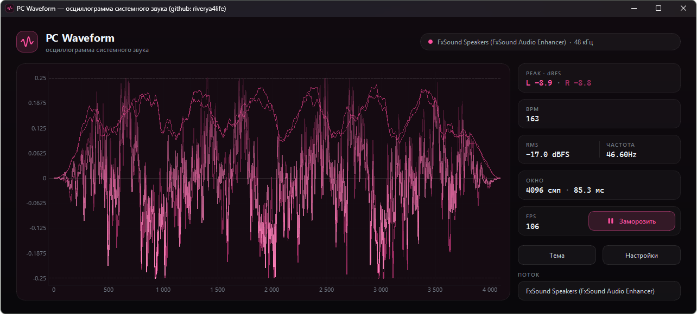
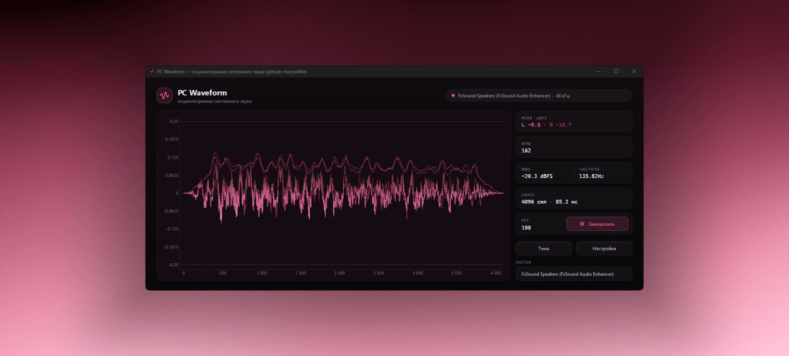

# PC Waveform — Осциллограмма системного звука

Реалтайм-осциллограмма звука с ПК через WASAPI loopback в современном тёмном интерфейсе.

Высокий FPS, плавная стабилизация, красивые цветовые темы и минималистичный UI.




---

## ✨ Обзор

**PC Waveform** — это визуализатор системного звука, построенный на **Python**, **PyQt6**, **pyqtgraph**, **NumPy** и **SoundCard**.

Программа захватывает звук, который реально играет на компьютере (loopback), и отображает чистую осциллограмму с:

- Стабилизацией по фронту сигнала
- Регулируемым окном и усилением
- Эффектом свечения
- 12 цветовыми темами с плавной анимацией
- Отображением Peak / RMS / FPS

Идеально подходит для мониторинга звука, стримов и просто визуального кайфа.

---

## 🎛 Возможности

### Audio Engine

- Реалтайм-захват системного звука (WASAPI Loopback)
- Высокий FPS (обновление ~1 мс)
- Стабилизация осциллограммы (триггер по фронту + гистерезис + захват фазы)
- Настраиваемый размер окна (1024 / 2048 / 4096 / 8192 сэмплов)
- Усиление ×1 / ×2 / ×4 / ×8
- Отображение Peak и RMS в dBFS

### Визуал

- Современный тёмный интерфейс
- 12 акцентных цветовых тем с анимацией перехода
- Эффект свечения осциллограммы
- Плавная заморозка / продолжение
- Адаптивный layout
- Тёмный titlebar в Windows

---

## 🖥 Платформа

Основная платформа:

- **Windows (WASAPI loopback)**

Другие системы могут работать в зависимости от поддержки `soundcard`, но Windows — приоритетная цель.

---

## 🚀 Установка
### 1. Зависимости
 
- Обязательные: `numpy`, `soundcard`, `pyqtgraph`, `PyQt6`
- Опциональные: `PyOpenGL` (OpenGL-бэкенд), `scipy` (быстрый bandpass)

### 2. Граф импортов
 
main → window → {w_dialogs, w_render, w_support}
w_render → w_support
window → {backend, settings, theme, audio, trigger, widgets, dsp, analysis}

### 3. Запуск
```bash
pip install -r requirements.txt
python main.py
```

## Кратко о программе

Это осциллограф системного звука на Python: `soundcard` захватывает WASAPI-loopback в кольцевой буфер (моно + L + R), UI на `pyqtgraph` рисует кривую (с триггером/стабилизацией, свечением, затуханием краёв), а рядом — плашки PEAK/RMS/Hz/FPS/бэкенд. Есть темы, i18n (ru/uk/en), соло-режим (ПКМ → безрамочное окно с прозрачным фоном), автовыбор бэкенда (OpenGL/Vulkan/Raster), и очень много микрооптимизаций под hot-path: preallocated буферы, in-place `multiply/clip`, зеркальный кольцевой буфер, даунсэмплинг, ленивое создание glow-объектов, GC freeze.
Подробнее прочитать можно [здесь](https://deepwiki.com/riverya4life/PC-Waveform)

## Модули
 
| Модуль | Содержимое |
|---|---|
| `backend.py` | переменные окружения, выбор OpenGL/растр (импортируется первым) |
| `settings.py` | константы, CONFIG (INI), локализация ru/uk/en, `tr()` |
| `theme.py` | темы, `make_qss`, цветовые хелперы, кастомные виджеты |
| `animations.py` | анимации контролов, запуска и перехода в/из соло-режима, `CascadeReveal` (каскад в диалогах) |
| `dsp.py` | Biquad-фильтры (low/mid/high) — scipy.lfilter или pure-Python |
| `analysis.py` | `BpmDetector`, `PeakHold` |
| `widgets.py` | WavePlotWidget, SpacedAxis, FlowLayout, Glow, Shadow, LevelMeter, TrailCurve |
| `audio.py` | многоканальный кольцевой буфер, `audio_snapshot`, Capturer |
| `trigger.py` | `TriggerMixin`: триггер и оценка частоты |
| `window.py` | `MainWindow`: сборка интерфейса и связь компонентов |
| `w_dialogs.py` | миксин темы, диалоги и обработчики настроек |
| `w_render.py` | миксин отрисовки кадров и обновления статистики |
| `w_support.py` | общие функции окна и демонстрационного сигнала |
| `main.py` | точка входа |

---

## Как высчитывается FPS

```python
self.frames = 0
self.t0 = time.perf_counter()

# в update_frame():
self.frames += 1

# в update_stats():
dt = now - self.t0
if dt >= FPS_AVG_S:                 # FPS_AVG_S = 0.25 c
    self._fps_val = self.frames / max(dt, 1e-3)
    self.frames = 0
    self.t0 = now
```

То есть **тумбл-окно 0.25 с**: считаем кадры, раз в 250 мс делим на прошедшее время и обнуляем. Показывается как `f"{fps:.0f}"`. В кадр не идут: скрытое/свёрнутое окно, заморозка (`self.frozen`), и «нет новых данных + не менялась сигнатура кадра» (`self._frame_sig`, `state["total_samples"]`).

Режимы FPS (`_apply_fps`):
- `0` — «Максимум»: кадры генерирует аудио-поток (chunk-driven), таймер — только страховка на 16 мс (CoarseTimer).
- `-1` — «По монитору»: `1000 / screen.refreshRate()`.
- фикс — `1000 / v`.

---

## Почему высокий FPS — не всегда хорошо

1. **Нет новой информации.** Аудио-чанк = 256 сэмплов при 48 кГц ≈ **5.33 мс**, значит ~187 «новых» кадров/с. Всё, что выше, — перерисовка одной и той же картинки.
2. **Экран не успевает.** Свыше герцовки монитора разницы глаз не увидит, а циклы CPU/GPU тратятся.
3. **Дорогой hot-path.** Каждый кадр — `setData` на `PlotCurveItem`, перестройка пути в `GlowItem` (`arrayToQPath`), обновление плашек. Без оптимизаций это были бы аллокации массивов × 60+ раз/с → GC-дёрганье.
4. **Тень.** Именно поэтому `QGraphicsDropShadowEffect` заменили на `StaticShadow`: в растровом режиме он **переразмывал карточку вместе с графиком каждый кадр**.
5. **Энергия/тепло.** На ноутбуке 240 FPS = троттлинг, шум вентиляторов, разряд батареи.
6. **Точные таймеры.** `PreciseTimer` держит системное разрешение 1 мс — нафиг не нужен в «Максимуме», поэтому там `CoarseTimer`.
7. **Соло с прозрачным фоном.** В GL нужен `NoPartialUpdate` + постоянная перерисовка (`_keepalive` каждые 100 мс) — дорогое удовольствие.
8. **Плашки.** Обновляются раз в 33 мс (`update_stats` троттлит до 30 Гц), а расчёт PEAK/RMS/FFT — раз в ~85 мс. При 240 FPS они бы всё равно обновлялись в 30–12 раз реже.

---
